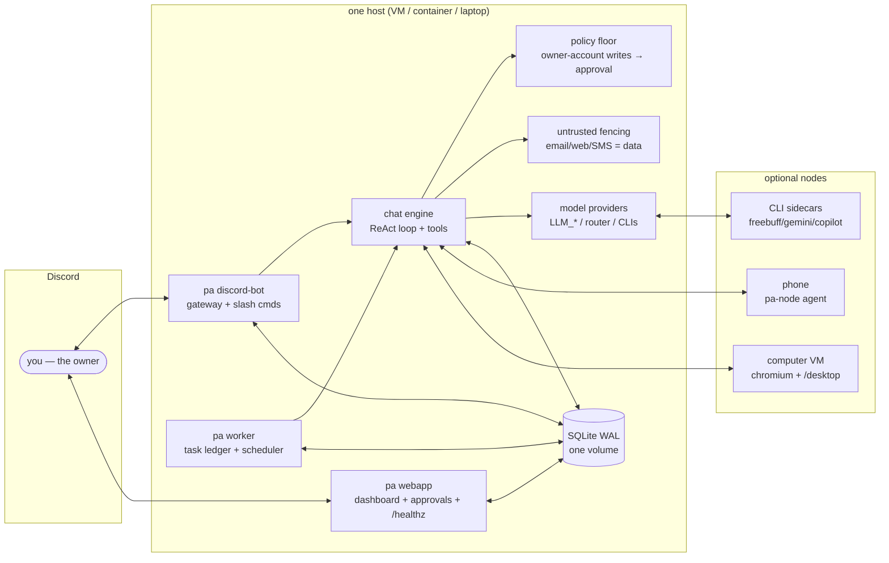

# pal

Your own personal assistant, self-hosted — a small headless Python
service you control. One owner account, several named assistants
(each with its own instructions and private memories), a durable task
queue, a durable scheduler, Gmail/Calendar/notes integrations, and
**Discord as the main interface** — slash commands plus free-form
conversational chat.

Designed to run on **free tier everything**: an Always Free VM (or any
Linux box, a home Pi, Docker, or your laptop), a free LLM API key, and
a Discord bot. The £0 path is real — nothing in the stack needs a paid
plan.

## What it does

- **Conversational chat** — DM the bot or @mention it and just talk.
  A ReAct agent loop decides which tools to call (web search, fetch,
  Gmail, Calendar, notes, reminders, files, images/PDFs) and answers
  in replies split under Discord's limit. Per-channel history lives in
  SQLite — recent turns verbatim, older ones summarised.
- **Connections library** — `/connect <app>` gives you a sign-in link;
  connect Notion, Linear, GitHub, Google, or any remote MCP server and
  its tools appear in chat. Tokens are sealed at rest; anything that
  isn't read-only needs an approval click. `docs/CONNECTIONS.md`.
- **Approvals everywhere** — every write/send/delete/spend on *your*
  accounts pauses for a Discord Approve/Reject click. Pal's own
  accounts act freely within budgets; unattended jobs queue drafts
  instead of acting.
- **Scheduler + proactive jobs** — durable daily/weekly/interval jobs:
  inbox triage, morning briefing (calendar + mail + dues + weather,
  as a voice note), reminders in plain language, standing monitors.
  All seeded **disabled** — enable per job.
- **Voice** — TTS voice notes out, Whisper transcription of audio
  messages in, and opt-in Discord voice-channel "calls" for urgent
  alerts (`docs/VOICE.md`).
- **Named assistants** — personas with custom instructions, tool
  allowlists, private memories, per-channel routing.
- **Optional extras, all off by default** — free-API failover router
  (Groq/Gemini/OpenRouter/Cloudflare/Pollinations), pal's own
  Chromium "computer" on a second VM, phone/computer **nodes**,
  budgeted sub-agents, made tools, a versioned self-improvement loop.
- **Safety model** — single owner allowlist, untrusted-content
  fencing (email/web/SMS is data, never instructions), a policy floor
  that approval-gates every owner-account write, secrets only ever in
  env. `docs/SECURITY.md`.

## Architecture



Stack: **Python 3.12 + SQLite + stdlib**, plus four pinned deps
(`waitress`, `cryptography`, `tzdata`, `pypdf`). No framework, no ORM,
no external services required to boot. One process runs web + worker +
scheduler + Discord bot; one volume holds all state.

## Quickstart

```sh
git clone https://github.com/Riyu-D1/pal.git && cd pal
scripts/setup.sh                 # venv + deps + writes .env (asks 3 values)
python -m pa create-owner        # web-UI login (username + password)
python -m pa serve               # http://127.0.0.1:8080 + Discord bot
curl http://127.0.0.1:8080/healthz
```

`setup.sh` needs only three values it can't invent: **a Discord bot
token**, **your Discord user id**, and **one LLM endpoint** (a free
Groq key works). Give it env vars instead of typing:

```sh
DISCORD_BOT_TOKEN=… DISCORD_OWNER_ID=… \
LLM_BASE_URL=https://api.groq.com/openai/v1 LLM_MODEL=llama-3.3-70b-versatile \
LLM_API_KEY=… scripts/setup.sh --non-interactive
python -m pa doctor              # what's configured / what's missing
```

Or with Docker:

```sh
cp .env.example .env   # fill in the same three values
docker compose up -d
docker compose exec pa python -m pa create-owner
```

Then DM the bot. **Hand the repo + `AGENTS.md` to your AI agent** and
it can do the whole setup for you — it will ask you only for the
secrets it can't create itself.

## Where to run it (£0 path)

| option | cost | notes |
|---|---|---|
| **Oracle Cloud Always Free** (Ampere A1 or micro) | £0 | best standing option — enough RAM for pal + scheduler + bot |
| any Linux VM / home box / Raspberry Pi | £0 | needs Python 3.11+ and outbound HTTPS only |
| Docker / docker compose on anything | £0 | `docker compose up -d`, one volume |
| local Mac/Linux dev | £0 | `PA_ENV=development`, loopback only |
| fly.io | ~$0–4/mo | `fly.toml.example`; the only documented non-loopback topology |

Models: Groq, Gemini, OpenRouter-free, Cloudflare Workers AI and
Pollinations all have real free tiers — the router fails over between
them (`docs/ROUTER.md`). Discord, Gmail, Cloudflare Tunnel, Obsidian
sync methods: all free. Total monthly cost can genuinely be zero.

## Owner checklist

Minimum: `DISCORD_BOT_TOKEN`, `DISCORD_OWNER_ID`, `LLM_*` (or
`PA_ROUTER_ENABLED` + one free backend key). Everything else opt-in —
Gmail+Calendar (`/connect google` or `GMAIL_*` env), notes
(`VAULT_PATH`), search (`TAVILY_API_KEY` or keyless DDG fallback),
voice extras, nodes, computer, router backends. See `docs/SETUP.md`
and `docs/CONFIG.md`.

## Docs

- **`AGENTS.md`** — hand this to your AI agent; it drives the whole
  setup end-to-end.
- `docs/SETUP.md` — manual walkthrough, every integration.
- `docs/CONFIG.md` — every env var + flag, with defaults.
- `docs/ARCHITECTURE.md` — components, ledger model, lifecycle.
- `docs/DEPLOY.md` — systemd + Docker + tunnel production deploy.
- `docs/TROUBLESHOOTING.md` — known failure modes and fixes.
- Feature docs: `PARITY` (chat/UX surface), `EVOLVE` (self-improvement),
  `JARVIS` (proactive), `CONNECTIONS`, `ROUTER`, `VOICE`, `COMPUTER`,
  `NODES`, `PHONE`, `WORKSPACE`, `SUBAGENTS`, `RESEARCH`, `TOOLMAKING`,
  `JOBS`, `WEBHOOKS`, `BACKUP`, `DR`, `RUNBOOK`, `SECURITY`,
  `INTEGRATIONS`, `PROVIDERS`, `FREEBUFF_CONNECTION`, `FEATURES`.

## Status

Full automated suite: **1500+ tests** against deterministic fakes
(Discord gateway, Gmail, model endpoints) — `python -m unittest
discover -s tests`. Live integrations need your credentials; anything
unconfigured reports "needs config", never fake success.

MIT licensed. Single-owner by design — one Discord user id, one
account, one machine.
